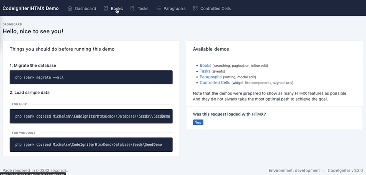

# CodeIgniter HTMX Demo

This is a demo for the [CodeIgniter HTMX](https://github.com/michalsn/codeigniter-htmx) helper library. It targets the final htmx 4 request/response model.

The demo requires:

- PHP 8.2 or later,
- CodeIgniter 4.7 or later,
- CodeIgniter HTMX 4.0 or later.



## Available demos

- **Books** - searching, pagination, inline edit
- **Tasks** - events
- **Paragraphs** - sorting, modal edit
- **Controlled Cells** - widget-like components, signed-urls (the last one requires [CodeIgniter Signed-URL](https://github.com/michalsn/codeigniter-signed-url) library)

## Installation

1. Install [CodeIgniter 4](https://codeigniter.com/) with Composer (command below) or [manually](https://codeigniter.com/user_guide/installation/installing_manual.html).

```console
composer create-project codeigniter4/appstarter:^4.7 codeigniterhtmx
cd codeigniterhtmx
```

2. Install the [CodeIgniter HTMX](https://github.com/michalsn/codeigniter-htmx) library with Composer (command below) or [manually](https://michalsn.github.io/codeigniter-htmx/installation/#manual-installation).

```console
composer require michalsn/codeigniter-htmx:^4.0
```

3. Download the ZIP file of this project and place it in the desired folder.

   - The example assumes that it will be `codeigniterhtmx/app/ThirdParty/htmx-demo`.
   - Then enable it by editing the `codeigniterhtmx/app/Config/Autoload.php` file and adding the `Michalsn\CodeIgniterHtmxDemo` namespace to the `$psr4` array, like in the below example:

```php
<?php

// ...

public $psr4 = [
    APP_NAMESPACE => APPPATH, // For custom app namespace
    'Config'      => APPPATH . 'Config',
    'Michalsn\CodeIgniterHtmxDemo' => APPPATH . 'ThirdParty/htmx-demo/src',
];

// ...
```

## Database

First, make sure to create a database for the project. You can name it `codeigniterhtmx` and set credentials for the database connection in `codeigniterhtmx/app/Config/Database.php`, see [framework's user guide](https://codeigniter.com/user_guide/database/configuration.html) for more information.

Before running the examples, you have to migrate the database. Make sure you have set the correct credentials for the database and then run the command:
```console
php spark migrate --all
```

And preferably run the seeds:

**For Unix:**
```console
php spark db:seed Michalsn\\CodeIgniterHtmxDemo\\Database\\Seeds\\SeedDemo
```

**For Windows:**
```console
php spark db:seed Michalsn\CodeIgniterHtmxDemo\Database\Seeds\SeedDemo
```

## Running the demo

The default route to the demo page is `demo`.

## htmx 4

The layout loads htmx 4.0.0 from jsDelivr with Subresource Integrity enabled. For production applications, consider [self-hosting htmx](https://four.htmx.org/docs#installing-htmx).

The examples demonstrate the htmx 4 API, including:

- explicit attribute inheritance with the `:inherited` suffix,
- built-in `outerMorph` swaps without the former Idiomorph extension,
- the standardized htmx 4 lifecycle event names,
- `<hx-partial>` responses for toast notifications.

When migrating an existing application, also consult the official [htmx 2 to htmx 4 migration guide](https://four.htmx.org/docs#migrating-from-htmx-2x-to-4x).
